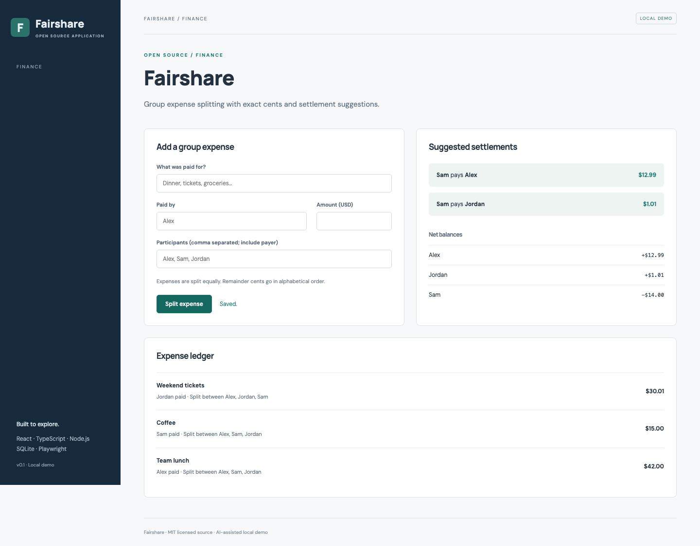

# Fairshare

Expense splitting. An independently runnable open source application.

## Run and demonstrate

From this repository, run `npm ci` and `npm run dev`. Open http://127.0.0.1:5173/#expenses.

Add a USD 30.01 expense paid by Jordan and shared by Alex, Sam, and Jordan. Inspect the ledger, net balances, and suggested settlements.

## Implementation and decisions

Amounts are stored as integer cents. Remainder cents are allocated alphabetically. Balances sum to zero; a deterministic greedy settlement flow matches debtors to creditors. This does not promise the minimum possible number of transfers.

API implementation: [`server/projects/expenses.ts`](server/projects/expenses.ts). The React workflow is in [`src/main.tsx`](src/main.tsx); storage initialization and shared middleware are in [`server/app.ts`](server/app.ts).

## API

- `GET /api/expenses` — list recorded expenses.
- `POST /api/expenses` — add `{label, payer, cents, participants}`; cents must be a positive integer.
- `GET /api/balances` — return net balances and deterministic settlement suggestions.

## Verification

Run `npm test` for domain/API checks. Run `npm run build`, then `npm run test:e2e` for browser flows, including **Fairshare adds an expense and updates settlement balances**.

## Application description

> Fairshare: a group expense splitter with exact integer-cents arithmetic, deterministic remainder allocation, zero-sum balance calculations, and settlement suggestions, backed by SQLite and tested API workflows.

Use this as a description of the current project. Add your own reviewed contribution and disclose AI assistance when discussing development. Do not attach invented employment dates, client claims, production usage, or years of experience.

## Next contribution

Add unequal percentage splits with exact-cent reconciliation and sum validation.

MIT licensed. Initial implementation created with AI assistance in October 2026; see [CONTRIBUTIONS.md](CONTRIBUTIONS.md).

## Scope

This is a single-user local demonstration with fictional data. It has no account authentication or multi-tenant authorization. Keep it bound to loopback. Initial code was developed with AI assistance in October 2026 and extracted from Portfolio Workbench.
